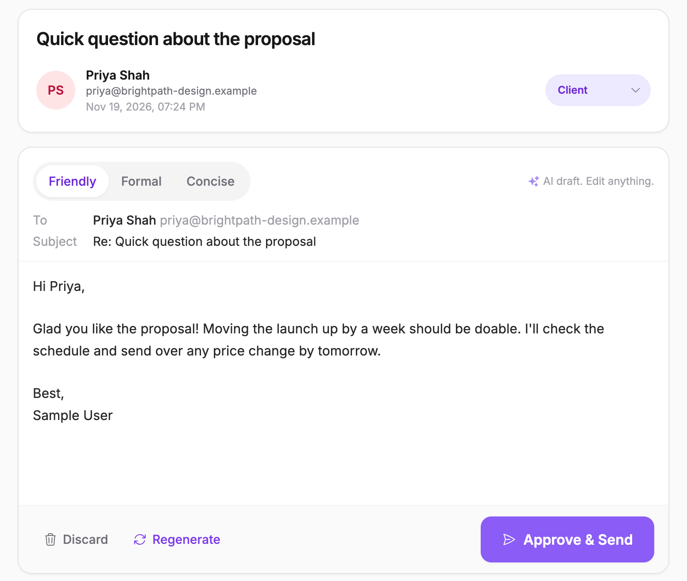
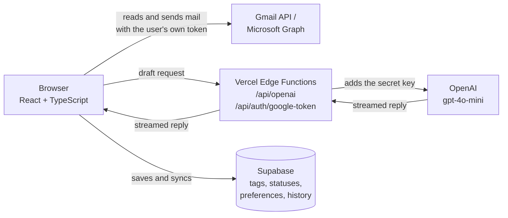

# MailAssist AI

An email assistant that reads your inbox and drafts the replies. You pick an email, choose a tone, watch the draft appear, edit it if you like, and approve it. Nothing is sent until you press the button.

**Live demo: [mailassist-ai.vercel.app](https://mailassist-ai.vercel.app)**. Click **"Try a demo, no sign-in"** to explore a sample inbox without connecting an account.



## What it does

- **Connects to Gmail or Outlook** with the account's own sign-in (Google OAuth, Microsoft MSAL).
- **Drafts a reply with AI** in one of three tones: Friendly, Formal or Concise. The reply streams in word by word.
- **Keeps the human in charge.** The draft is fully editable, and nothing is sent or deleted until you approve it.
- **Helps you triage.** Tag emails (Urgent, Client, Billing...), mark them replied or ignored, and filter the inbox by status and tag.
- **Remembers past replies.** If a new email looks like one you've answered before, it offers to reuse that reply.
- **Has a no-sign-in demo** with a fake inbox, so anyone can see the AI part without handing over their real email.

## How it works



**Writing a reply, step by step**

1. The user signs in. Google uses OAuth with PKCE, and Microsoft uses MSAL. The browser then talks to Gmail or Microsoft Graph directly, with that user's own access token.
2. When the user presses **Generate AI Reply**, the app builds a prompt from the email, the chosen tone and the user's name (`src/utils/prompts.ts`). Long emails are trimmed to 3,000 characters first.
3. The request goes to `/api/openai`, a small Vercel Edge Function. It adds the OpenAI key, which only exists on the server, and passes the model's streamed answer straight back.
4. The browser shows the reply as it arrives. The user can edit it, switch tone to write a fresh draft, or regenerate.
5. On **Approve & Send**, the reply goes out through Gmail or Outlook, and the email is marked as replied.

**Sample mode** is a separate path. It uses a built-in set of six made-up emails and pre-written replies. It never contacts Gmail, Outlook, OpenAI or the database.

## Why I built it this way

- **Secrets stay on the server.** An early version kept the OpenAI key and Google client secret in `VITE_` settings, and anything with that prefix gets bundled into the page where anyone can read it. I moved both into Vercel Edge Functions (`api/openai.ts`, `api/auth/google-token.ts`). The browser never sees them.
- **PKCE for Google sign-in.** The app runs in a browser, so it can't hold a secret. PKCE proves the sign-in came from the same session without one. The client secret that Google still requires lives only in the server function.
- **A small, cheap model.** Email replies are short, so I used `gpt-4o-mini`: fast, inexpensive, and good enough for a few paragraphs. Streaming makes the wait feel short.
- **Human approval, always.** The app drafts but never sends on its own. The permission note on the login screen says so, and the code backs it up: sending and deleting only happen from a button the user presses.
- **Honest about cost.** The app retries once after a rate limit, but not when the account is out of credit, because waiting can't fix that. Two extra AI features (draft quality scoring and urgency sorting) are built but switched off, to protect the free-tier quota.
- **Friendly errors.** If the AI can't answer, people see "The assistant is busy, please try again in a minute." The technical reason goes to the browser console, not the screen.
- **Fast first, synced second.** Tags, statuses and preferences are saved on the device immediately and copied to Supabase in the background. The screen never waits on the network, and the data follows the user to another device.
- **A demo that can't be abused.** Sample mode replies are pre-written on purpose. A public "try it" button that called OpenAI would cost money on every click and invite abuse. The demo still shows the whole flow: pick an email, watch a draft type out, switch tone, approve.
- **Untrusted email is handled carefully.** Emails with HTML are shown in a sandboxed frame with scripts turned off, so a malicious email can't run code in the app.

## What I'd improve next

I'm listing these on purpose, in rough order of importance:

1. **Lock down the database.** The [setup script](emailassistant/supabase-setup.sql) switches Row Level Security off, and rows are keyed by email address, so the public key in the page could read and write any row. The next step is real authentication plus Row Level Security. The history table also keeps a short snippet of each email for the "similar question" feature, which I'd move on-device or encrypt.
2. **Lock down `/api/openai`.** It passes the request body to OpenAI unchanged, with no sign-in check or rate limit, so someone could spend the credit on other prompts. It should allow only one model, cap the reply length, require a signed-in session and rate-limit by user.
3. **Keep sign-in tokens out of the browser's storage.** They're stored in `localStorage`, which exposes them if a script ever runs on the page. Refresh tokens belong on the server in `httpOnly` cookies.
4. **Add automated tests.** There are none yet. I'd start with unit tests for the prompt builder, email parsing and similar-reply matching, then an end-to-end test of the demo flow.
5. **Switch the paused features back on**, draft quality scoring and urgency sorting, once there's a billing plan to cover the extra calls.
6. **Load more mail.** Gmail loads the 15 most recent inbox emails and Outlook loads 50, with no paging or search.
7. **Give the AI more context.** Use the whole email thread, and learn the user's writing style from the replies they've approved.
8. **Prepare for a public launch.** Gmail's permissions are classed as restricted, so a public launch needs Google's app verification, plus a privacy policy and terms page.
9. **Trim the bundle.** The main JavaScript file is over 800 kB. Splitting it by screen would speed up the first load.

## Run it yourself

You need Node 20.19 or newer (or Node 22.12+).

```bash
git clone https://github.com/Ghub10/mailassist-ai.git
cd mailassist-ai/emailassistant
npm install
npm run dev
```

Open <http://localhost:5173> and click **Try a demo, no sign-in**. Sample mode needs no keys or accounts.

To connect a real inbox and get real AI replies, copy `.env.example` to `.env` and fill it in.

| Variable | Where it's used | Visible in the browser? |
|---|---|---|
| `VITE_GOOGLE_CLIENT_ID` | Google sign-in | Yes, it's public by design |
| `VITE_MICROSOFT_CLIENT_ID` | Microsoft sign-in | Yes, it's public by design |
| `VITE_APP_URL` | OAuth redirect address | Yes |
| `VITE_SUPABASE_URL`, `VITE_SUPABASE_ANON_KEY` | Syncing tags, statuses and history | Yes (optional, the app runs without them) |
| `GOOGLE_CLIENT_SECRET` | Server function `api/auth/google-token` | **No, server only** |
| `OPENAI_API_KEY` | Server function `api/openai` | **No, server only** |

`npm run dev` doesn't run the `api/` functions. To try real AI replies on your computer, run `npx vercel dev` instead.

**Deploying to Vercel:** set the project's **Root Directory** to `emailassistant`, add the variables above, and add your Vercel address to the Google and Microsoft redirect lists. If you use Supabase, run [`emailassistant/supabase-setup.sql`](emailassistant/supabase-setup.sql) once in its SQL editor.

## Tech stack

React 19, TypeScript, Vite, Tailwind CSS, Framer Motion, React Router, MSAL (Microsoft sign-in), Supabase, Vercel Edge Functions, OpenAI `gpt-4o-mini`.

## Project layout

```
emailassistant/
  api/            Vercel Edge Functions (OpenAI proxy, Google token exchange)
  public/         Icons and the screenshot above
  src/
    screens/      Login, Inbox, Email + reply, Settings
    components/   Reply editor, avatars, badges, buttons
    services/     Gmail, Outlook, OpenAI, sign-in and Supabase clients
    context/      Sign-in and inbox state
    hooks/        Fetching emails, writing drafts
    data/         The sample-mode emails and replies
    utils/        Prompts, email parsing, local storage
docs/             The original product notes: requirements, design system, test plan
```
